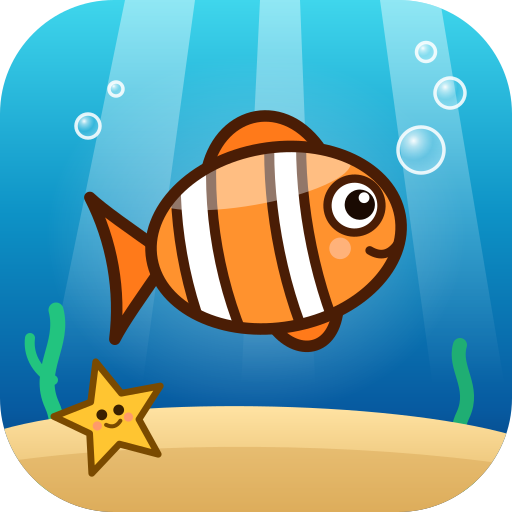

# Reef Crush

An ocean-themed match-3 puzzle game, inspired by Candy Crush, built as an installable **Progressive Web App**. It is plain HTML, CSS and JavaScript with no framework and no build step, and is ready to deploy on Vercel.

<p align="center"></p>

## Features

- **20 hand-tuned levels** on a winding level map, each with a move limit and 1–3 stars.
- **Four goal types:** reach a score, collect creatures, clear coral (one or two layers), break ice and rocks.
- **Specials:** striped creatures (match 4), bubble creatures (L or T match), Rainbow Pearls (match 5), and combos when two specials are swapped together.
- **Touch-first controls:** swipe a creature, or tap one and then its neighbour. Works in portrait and landscape.
- **Extras:** synthesised sound effects, haptic feedback (Android), hints after 5 seconds idle, auto-shuffle, saved stars and best scores, and a "Play any level" switch.
- **PWA:** installable to the home screen, runs full screen, and plays offline once loaded.

## Install it on your phone

1. Open the deployed site on your phone.
2. **Android (Chrome, Edge, Samsung Internet):** tap the download button at the top of the level map, or use the browser menu's **Install app**.
3. **iPhone / iPad (Safari):** tap **Share**, then **Add to Home Screen**. The download button on the map shows these steps too.

Progress is stored on the device (localStorage), so each phone keeps its own stars.

## Project structure

```
public/                 Everything Vercel serves (no build step)
  index.html            Game markup and the SVG creature artwork
  css/styles.css        All styles
  js/engine.js          Game rules: matching, specials, cascades, obstacles, goals (no DOM; also runs in Node)
  js/levels.js          The 20 level layouts, goals and star thresholds
  js/game.js            Rendering, animations, touch input, sound, haptics, saving
  js/pwa.js             Service-worker registration, install button, update toast
  sw.js                 Service worker: offline app shell, cached fonts
  manifest.webmanifest  App name, colours, icons and store screenshots
  icons/                App icons (generated, see below)
  screenshots/          Screenshots used by the install dialog
design/app-icon.svg     Editable master artwork for the app icon
scripts/build-icons.mjs Generates every icon size from the master artwork
tests/                  Engine and PWA tests, and a bot that checks level difficulty
vercel.json             Vercel settings and headers
```

## Run locally

```bash
npm start            # serves public/ at http://localhost:3000
```

Any static file server works (for example `python3 -m http.server -d public 3000`). Service workers only run on `https://` or `localhost`.

## Deploy to Vercel

1. In Vercel, choose **Add New → Project** and import this GitHub repository.
2. Leave the defaults. `vercel.json` already sets the framework to *Other*, skips the install step and serves the `public/` folder.
3. Deploy. Every push to `main` redeploys automatically.

Or from the command line: `npx vercel --prod`.

## Releasing an update

Change the `VERSION` string at the top of `public/sw.js` whenever you change any game file. Installed copies pick up the new version the next time they open and show a **Reload** prompt.

## Editing the icon

Edit `design/app-icon.svg` (named groups: `#background` and `#artwork`), then run:

```bash
npm install          # installs sharp, used only for rendering icons
npm run icons
```

This writes the rounded icon, the maskable icon (artwork pulled into the safe zone for circular launchers), the Apple touch icon and the favicon into `public/icons/`.

## Tests

```bash
npm test             # plays every level to the end and checks board consistency and PWA files
npm run balance      # greedy-bot win rates and star spread per level
```

## Adding or tuning levels

Levels live in `public/js/levels.js`. Each layout is 8 strings of 8 characters:

| Char | Meaning | Char | Meaning |
|---|---|---|---|
| `.` | normal cell | `#` | gap in the board |
| `j` | coral (1 layer) | `J` | coral (2 layers) |
| `i` | frozen creature | `k` / `K` | frozen creature on 1- / 2-layer coral |
| `r` | rock (1 hit) | `R` | boulder (2 hits) |

Run `npm run balance` after changes to check the difficulty curve.
